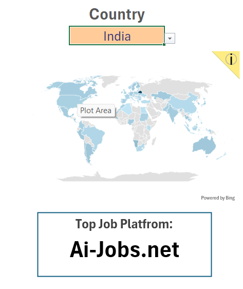
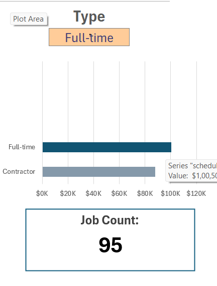

<h1 align="center">📊 Data Jobs Salary Dashboard</h1>

<p align="center">
  <b>An interactive Excel dashboard to explore data job salaries by job title, country, and job type.</b><br>
  Built with Excel formulas, dropdown filters, and dynamic charts.
</p>

<p align="center">
  
  
  
</p>

<hr>

<h2>📑 Table of Contents</h2>

<ol>
  <li><a href="#overview">Overview</a><br></li>
  <li><a href="#questions">The Questions</a><br></li>
  <li><a href="#tools">Tools I Used</a><br></li>
  <li><a href="#data">About the Data</a><br></li>
  <li><a href="#dashboard">The Dashboard</a><br></li>
  <li><a href="#how">How It Works</a><br></li>
  <li><a href="#learned">What I Learned</a><br></li>
  <li><a href="#challenges">Challenges I Faced</a><br></li>
  <li><a href="#run">How to Use This Project</a><br></li>
  <li><a href="#conclusion">Conclusion</a></li>
</ol>

<hr>

<h1 id="overview">🔎 Overview</h1>

<h3>Welcome to my Data Science Salary Dashboard.</h3>

<p>
This project turns a large table of job postings into a simple, interactive dashboard.
With three dropdown filters (<b>Job Title</b>, <b>Country</b> and <b>Type</b>), anyone can quickly see
what a role pays, where jobs are posted, which platform lists the most jobs, and how many jobs match.
</p>

<details>
  <summary><b>👉 Click to see what the dashboard shows</b></summary>
  <br>
  <ul>
    <li><b>Median salary</b> for the selected job title</li>
    <li><b>Salary comparison</b> across job titles, with the selected one highlighted</li>
    <li><b>World map</b> of job postings by country</li>
    <li><b>Top job platform</b> for the selected filters</li>
    <li><b>Salary comparison</b> across job types (Full-time, Contractor and so on)</li>
    <li><b>Job count</b> for the selected filters</li>
  </ul>
</details>

<br>

<h1 id="questions">❓ The Questions</h1>

<h3>Below are the questions I wanted to answer with this dashboard:</h3>

<ol>
  <li><b>What is the median salary for a given job title?</b></li>
  <br>
  <li><b>How does that job title compare with other data roles?</b></li>
  <br>
  <li><b>Which countries have the most job postings?</b></li>
  <br>
  <li><b>Which job platform lists the most jobs in a given country?</b></li>
  <br>
  <li><b>How does pay differ between Full-time, Contractor and other job types?</b></li>
  <br>
  <li><b>How many jobs match the selected title, country and type?</b></li>
</ol>

<br>

<h1 id="tools">🛠️ Tools I Used</h1>

<table align="center">
  <thead>
    <tr>
      <th align="left">Tool / Feature</th>
      <th align="left">Purpose</th>
    </tr>
  </thead>
  <tbody>
    <tr><td><b>📗 Microsoft Excel</b></td><td>Building the whole dashboard</td></tr>
    <tr><td><b>🗂️ Excel Table</b></td><td>Storing the job data in a structured, named table</td></tr>
    <tr><td><b>🔽 Data Validation</b></td><td>Dropdown filters for Job Title, Country and Type</td></tr>
    <tr><td><b>🔍 XLOOKUP</b></td><td>Pulling the selected values into the summary boxes</td></tr>
    <tr><td><b>🔢 COUNTIFS</b></td><td>Counting jobs and platform postings for the selected filters</td></tr>
    <tr><td><b>🧮 Array formulas</b></td><td>Building the unique, sorted lists and the median calculations</td></tr>
    <tr><td><b>📊 Charts and Map chart</b></td><td>Bar charts and a world map that update with the filters</td></tr>
    <tr><td><b>🔀 Git &amp; GitHub</b></td><td>Version control and sharing the project</td></tr>
  </tbody>
</table>

<br>

<h1 id="data">📦 About the Data</h1>

<p>
The <code>Data</code> sheet holds <b>32,672 job postings</b> across <b>16 columns</b>.
</p>

<details>
  <summary><b>👉 Click to see the main columns</b></summary>
  <br>
  <table>
    <thead>
      <tr><th align="left">Column</th><th align="left">Description</th></tr>
    </thead>
    <tbody>
      <tr><td><code>job_title_short</code></td><td>Standardized job title</td></tr>
      <tr><td><code>job_country</code></td><td>Country of the job posting</td></tr>
      <tr><td><code>job_schedule_type</code></td><td>Job type (Full-time, Contractor, Part-time and so on)</td></tr>
      <tr><td><code>job_via</code></td><td>Platform where the job was posted</td></tr>
      <tr><td><code>salary_year_avg</code></td><td>Average yearly salary</td></tr>
      <tr><td><code>job_skills</code></td><td>Skills required for the job</td></tr>
    </tbody>
  </table>
</details>

<br>

<h1 id="dashboard">📈 The Dashboard</h1>

<p>
The workbook has 7 sheets. The <code>Salary_Dashboard</code> sheet is the one people use.
The other sheets (<code>Data Validation</code>, <code>Jobs</code>, <code>Country</code>, <code>Type</code> and <code>Platform</code>) hold the helper calculations behind it.
</p>

<h2>1️⃣ Job Title: median salary and comparison</h2>

<p>
Pick a job title and the dashboard shows its <b>median salary</b>.
The bar chart ranks all job titles by median salary, and the selected one is <b>highlighted in a darker color</b>.
</p>

<p align="center">
  
</p>
<p align="center"><i>Selecting "Data Analyst" highlights its bar and shows the median salary below.</i></p>

<hr>

<h2>2️⃣ Country: job map and top platform</h2>

<p>
Pick a country and the map shows where jobs are posted. The box below shows the <b>top job platform</b> for that selection.
</p>

<p align="center">
  
</p>
<p align="center"><i>Selecting "India" shows Ai-Jobs.net as the top job platform.</i></p>

<hr>

<h2>3️⃣ Type: pay by job type and job count</h2>

<p>
Pick a job type and the bar chart compares the median salary of each type. The <b>Job Count</b> box shows how many jobs match all selected filters.
</p>

<p align="center">
  
</p>
<p align="center"><i>Selecting "Full-time" for Data Analyst jobs in India shows 95 jobs.</i></p>

<h3>💡 Key Takeaways</h3>

<ul>
  <li>For the filters shown in the screenshots (Data Analyst, India, Full-time), the median salary is <b>$1,00,500</b> and there are <b>95</b> matching jobs.</li>
  <li>Senior and engineering roles sit at the top of the salary ranking, and Data Analyst sits in the middle.</li>
  <li>The top job platform changes with the country, so the dropdown is useful for deciding where to search.</li>
</ul>

<br>

<h1 id="how">⚙️ How It Works</h1>

<ol>
  <li><b>Store the data</b> in an Excel Table named <code>jobs</code>.</li>
  <br>
  <li><b>Create dropdowns</b> with Data Validation. The lists come from unique, sorted helper columns.</li>
  <br>
  <li><b>Name the selected cells</b> <code>title</code>, <code>country</code> and <code>type</code>, so formulas can use them easily.</li>
  <br>
  <li><b>Calculate</b> the median salary and job counts for the selected filters.</li>
  <br>
  <li><b>Highlight the selection</b> in the charts by splitting each series in two with an <code>IF</code> formula, so the chosen item gets its own color.</li>
  <br>
  <li><b>Link everything</b> to the <code>Salary_Dashboard</code> sheet, so every chart and box updates when a dropdown changes.</li>
</ol>

<details>
  <summary><b>👉 Click to see example formulas</b></summary>
  <br>

```excel
=XLOOKUP(title, $D$2:$D$11, $E$2:$E$11)
```

```excel
=COUNTIFS(jobs[job_via], A2, jobs[job_title_short], title, jobs[job_country], country, jobs[job_schedule_type], type)
```

```excel
=IF($D2=title, $E2, NA())
```

</details>

<br>

<h1 id="learned">🎓 What I Learned</h1>

<ol>
  <li><b>Dynamic dashboards:</b> dropdowns, named cells and lookups make one sheet react to the user's choice.</li>
  <br>
  <li><b>Excel Tables:</b> structured names such as <code>jobs[job_via]</code> keep formulas readable and update as the data grows.</li>
  <br>
  <li><b>Highlighting in charts:</b> splitting a series with <code>IF</code> and <code>NA()</code> colors only the selected bar.</li>
  <br>
  <li><b>Clear design:</b> a few well-labeled filters and summary boxes tell the story faster than many charts.</li>
</ol>

<br>

<h1 id="challenges">🧗 Challenges I Faced</h1>

<ol>
  <li><b>Missing salaries:</b> many postings have no salary value, so medians use only rows that have one.</li>
  <br>
  <li><b>Messy job types:</b> values such as "Full-time and Contractor" had to be handled carefully.</li>
  <br>
  <li><b>Combined filters:</b> some title, country and type combinations have very few jobs, so results can be noisy.</li>
  <br>
  <li><b>Map accuracy:</b> the map chart matches country names, so names must be spelled the way Excel expects.</li>
</ol>

<br>

<h1 id="run">▶️ How to Use This Project</h1>

<ol>
  <li>Download <code>1_Salary_Dashboard.xlsx</code> from this repository.</li>
  <br>
  <li>Open it in <b>Microsoft Excel</b> (a recent version with <code>XLOOKUP</code> and dynamic arrays is needed).</li>
  <br>
  <li>Go to the <code>Salary_Dashboard</code> sheet.</li>
  <br>
  <li>Use the <b>Job Title</b>, <b>Country</b> and <b>Type</b> dropdowns to explore the data.</li>
</ol>

<h3>📁 Project Structure</h3>

```text
📦 salary-dashboard
 ┣ 📂 images/
 ┃ ┣ 🖼️ 1_job_title.png
 ┃ ┣ 🖼️ 2_country.png
 ┃ ┗ 🖼️ 3_type.png
 ┣ 📗 1_Salary_Dashboard.xlsx
 ┗ 📄 README.md
```

<br>

<h1 id="conclusion">✅ Conclusion</h1>

<p>
This dashboard shows how Excel alone can turn thousands of job postings into a clear, interactive tool.
In a few clicks, a job seeker can compare salaries between roles, see which platform lists the most jobs in a country, and check how many jobs match their choices.
</p>

<hr>

<p align="center">⭐ If you found this project useful, please consider giving it a star!</p>
